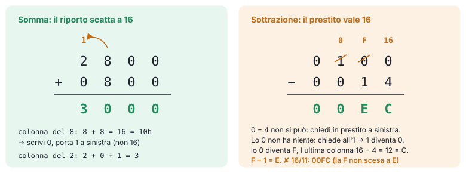
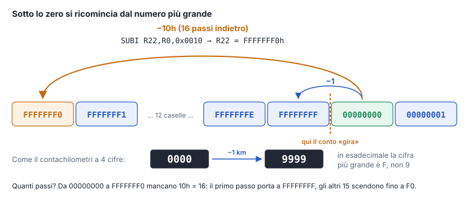
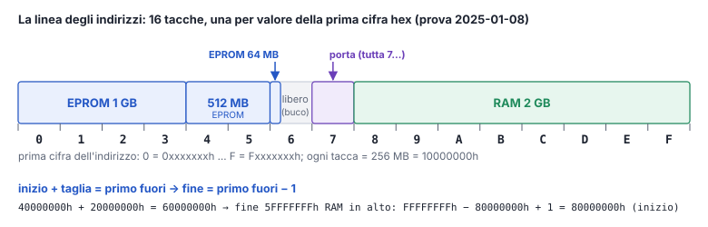

> [!info] Come si usa, e come si lega al prontuario
> Questo file risponde a **«come si fa questo conto?»**: conversioni, potenze di due, somme e
> sottrazioni in esadecimale, numeri sotto lo zero, inizio e fine dei blocchi.
> Il [[prontuario_CALC]] risponde a **«cosa scrivo in questo pezzo della prova?»** (P1 mappa, P2
> decodifica, P3 collegamenti, P8 handler) e, quando serve un conto, rimanda qui con
> *→ conti §n*. All'esame non si porta niente (dispensa 01 p. 8): si rifà a memoria.
> Colori: **blu** regola · **verde** esempio · **arancio** errore già fatto · **viola** perché.
> PDF: `scripts/pdf_grafico.sh`; disegni rigenerabili con `img/genera_svg.py`.

# Le cifre: binario, esadecimale, decimale


## Esadecimale ↔ binario

> [!regola] Una cifra esadecimale = 4 bit esatti
> La `h` in fondo vuol dire «esadecimale» ed è un'etichetta: nei conti non entra.

| hex | bin | hex | bin | hex | bin | hex | bin |
|---|---|---|---|---|---|---|---|
| 0 | `0000` | 4 | `0100` | 8 | `1000` | C (12) | `1100` |
| 1 | `0001` | 5 | `0101` | 9 | `1001` | D (13) | `1101` |
| 2 | `0010` | 6 | `0110` | A (10) | `1010` | E (14) | `1110` |
| 3 | `0011` | 7 | `0111` | B (11) | `1011` | F (15) | `1111` |

Per ricostruire la tabella senza ricordarla: `A` = 10 … `F` = 15, poi la conversione del §1.3.

> [!esempio] Nei due versi
> **Da hex a binario**: ogni cifra diventa i suoi 4 bit.
> `2800h` = `0010 1000 0000 0000` · `C000h` = `1100 0000 0000 0000`
>
> **Da binario a hex**: gruppi di 4 **partendo da destra**, poi ogni gruppo diventa una cifra.
> `0010 0111 1111 1111` = `27FFh`

> [!attenzione] Una cifra è sempre 4 bit
> `1111` = `F`, non `1`: sedici bit alti tutti a 1 sono `FFFF`. Un indirizzo DLX ha **8 cifre**:
> se ne conti 7 (`4000000h`) ne manca una davanti (`04000000h`).

## Binario → decimale

Ogni posizione vale il doppio di quella alla sua destra: somma i pesi dove c'è `1`.

```
pesi:  16 8 4 2 1
           1 1 0 0   →  8 + 4       = 12
           1 1 0 1   →  8 + 4 + 1   = 13
        1  0 1 1 0   →  16 + 4 + 2  = 22
```

> [!attenzione] Errore del 8/10
> `1100` letto come 8: c'è anche il 4. Controllo: rifai la somma partendo da destra.

## Decimale → binario

Togli la potenza di due più grande che ci sta, metti `1` in quella posizione, ripeti col resto.
Dove non togli niente, `0`.

```
12:  ci sta 8 → resto 4;  ci sta 4 → resto 0           → 1100
6:   non ci sta 8;  ci sta 4 → resto 2;  ci sta 2 → 0  → 0110
```

## Decimale → esadecimale

Quante volte ci sta 16, più il resto.

```
20  = 1·16 + 4   → 14h
100 = 6·16 + 4   → 64h
```

## Bit alti e bit bassi

«Alti» = le cifre **a sinistra**, che pesano di più. «Bassi» = quelle **a destra**.

- i **K bit bassi** scelgono la **cella** dentro il chip (vanno ai piedini `A[K-1..0]`);
- i bit **alti** che restano scelgono **quale chip**: sono quelli del `CS`.

```
3 bit, chip da 4 celle (K = 2):    1 | 0 1
                                chip | cella
```

**Dove stanno i bit su 16 bit** (4 cifre):

```
    C        0        0        0
A15..A12  A11..A8   A7..A4   A3..A0
```

`A13` è il secondo bit della prima cifra; `A11` il primo della seconda. Su 32 bit vale lo stesso
con 8 cifre: prima cifra `BA31..BA28`, seconda `BA27..BA24`, terza `BA23..BA20`.

# Potenze di due e taglie

## Da sapere a memoria

| 2^0 | 2^1 | 2^2 | 2^3 | 2^4 | 2^5 | 2^6 | 2^7 | 2^8 | 2^9 | 2^10 |
|---|---|---|---|---|---|---|---|---|---|---|
| 1 | 2 | 4 | 8 | 16 | 32 | 64 | 128 | 256 | 512 | 1024 |

> [!regola] Le unità: ogni gradino è ×1024, cioè +10 all'esponente
> **K = 2^10 · M = 2^20 · G = 2^30.** M non è 10^6 e non è 2^4.
> **2 GB = 2048 MB**, non 2000: è già una potenza di due (2^31).

## Perché una potenza di due è «1 seguito da zeri»

In **ogni base**, la base elevata alla n si scrive 1 seguito da n zeri, perché «10» vuol dire *la
base stessa*: 10^3 = `1000` in decimale, 2^3 = `1000` in binario = 8. In base 2, a ogni zero
aggiunto il valore **raddoppia** invece di decuplicare.

| Potenza | Decimale | Binario |
|---|---|---|
| 2^0 | 1 | `1` |
| 2^1 | 2 | `10` |
| 2^2 | 4 | `100` |
| 2^3 | 8 | `1000` |
| 2^4 | 16 | `10000` |
| 2^8 | 256 | `100000000` |
| 2^10 | 1024 (1 K) | `1` + 10 zeri |
| 2^20 | 1.048.576 (1 M) | `1` + 20 zeri |
| 2^30 | 1.073.741.824 (1 G) | `1` + 30 zeri |

> [!attenzione] Errore del 20/10
> `1000…0` con trenta zeri letto come «2». È **2^30** = 1 GB: l'esponente si legge **contando gli
> zeri**, non guardando l'1.

## Da una taglia ai bit interni K

> [!regola] Spezza in numero × unità, scrivi tutti e due come potenze di due, somma gli esponenti

```
32 KB  = 2^5 × 2^10 = 2^15   → K = 15
512 KB = 2^9 × 2^10 = 2^19   → K = 19
64 MB  = 2^6 × 2^20 = 2^26   → K = 26
2 GB   = 2^1 × 2^30 = 2^31   → K = 31
```

- **K = piedini d'indirizzo del chip** (`A[K-1..0]`); un chip da 128 KB ha `A0`…`A16`.
- **32 − K = bit che scelgono il blocco** (DLX a 32 bit). 2 GB → resta 1 bit: `BA31`.

> [!attenzione] L'unità persa (8/10, 9/10, 20/10)
> «32 KB → 5», «16K = 2^4», «64 MB → 2^6», «512 MB → 9·3 = 27». Si scrivono **sempre due**
> potenze, e gli esponenti si **sommano**: 2^9 · 2^20 = 2^29.

## Le taglie in esadecimale

La taglia scritta in hex è anche il **primo indirizzo dopo** un blocco che parte da 0.

| Taglia | Potenza | Hex (32 bit) | | Taglia | Hex (16 bit) |
|---|---|---|---|---|---|
| 1 MB | 2^20 | `00100000h` | | 1K | `0400h` |
| 16 MB | 2^24 | `01000000h` | | 2K | `0800h` |
| 64 MB | 2^26 | `04000000h` | | 4K | `1000h` |
| 128 MB | 2^27 | `08000000h` | | 8K | `2000h` |
| 256 MB | 2^28 | `10000000h` | | 16K | `4000h` |
| 512 MB | 2^29 | `20000000h` | | 32K | `8000h` |
| 1 GB | 2^30 | `40000000h` | | | |
| 2 GB | 2^31 | `80000000h` | | | |

> [!regola] Ricavarle senza tabella
> Dividi l'esponente per 4: il **quoziente** è il numero di zeri in fondo, il **resto** dice la
> cifra davanti (resto 0 → `1`, 1 → `2`, 2 → `4`, 3 → `8`).
> `2^30`: 30 = 4·7 + 2 → `4` e 7 zeri → `40000000h`.
> `2^26`: 26 = 4·6 + 2 → `4` e 6 zeri → `04000000h` (8 cifre: si riempie a sinistra).
> Raddoppiando, la cifra raddoppia: 4 → 8 → 1(0) → 2 → 4 → 8.

## k · 2^n in esadecimale

k in binario, poi n zeri, poi gruppi da 4 **da destra**. L'1 sta a **sinistra**.

```
2^14     = 100 0000 0000 0000            = 0100 0000 0000 0000 = 4000h
3 · 2^29 = 11 + 29 zeri = 0110 0000 …    = 60000000h
```

## Quanti chip

Il numero davanti alla K in binario: **un solo 1** → un chip; più 1 → un chip per ogni 1 (se il
testo non dà le taglie disponibili).
`16 = 10000` → un chip · `12 = 1100` → 8K + 4K · `24 = 11000` → 16K + 8K.
Nell'esercizio 10 il docente sceglie 8K + 2K + 2K: va bene, ma non è la scomposizione minima.

# Somme e sottrazioni in esadecimale



> [!regola] Come in decimale, ma la soglia è 16
> Si lavora **una colonna alla volta, da destra**. In ogni colonna va **una cifra sola**: le
> lettere si traducono in numero (A = 10 … F = 15), si fa il conto, e un risultato da 10 a 15 si
> ritraduce in lettera.
>
> | | Decimale | Esadecimale |
> |---|---|---|
> | **Riporto** | la colonna arriva a 10 → scrivi il resto, porta 1 | arriva a **16** → scrivi `colonna − 16`, porta **1** |
> | **Prestito** | la cifra sopra è piccola → prendi 10 dalla vicina | prendi **16** dalla vicina, che scende di 1 |
> | **Vicina a 0** | lo 0 diventa 9 e il prestito va oltre | lo 0 diventa **F** e il prestito va oltre |

## Somma: il riporto

> [!esempio] Inizio di un blocco + taglia = inizio del pezzo dopo
> ```
>   2000h            2800h              1ACh
> + 0800h  (2K)    + 0800h  (2K)      +  27h
>   -----            -----              ----
>   2800h            3000h              1D3h
> ```
> `8 + 8 = 16` → scrivi 0, porta 1. · `C + 7 = 12 + 7 = 19` → 19 − 16 = 3, porta 1.

**Coppie che fanno esattamente 10h** (scrivi 0, porta 1), utili per andare veloci:

| 1+F | 2+E | 3+D | 4+C | 5+B | 6+A | 7+9 | 8+8 |
|---|---|---|---|---|---|---|---|

## Più uno: le F traboccano

La F è la cifra più grande: `F + 1 = 0` con riporto, e il riporto scorre su **tutte** le F
consecutive.

```
27FFh     + 1 = 2800h
7FFFFFFFh + 1 = 80000000h
FFFFFFFFh + 1 = (1)00000000h   → su 32 bit l'1 esce e si perde: 00000000h
```

## Sottrazione: il prestito

> [!esempio] Due prestiti, uno che passa sopra uno 0
> ```
>  10000h  (64K)          0100h
> − 4000h  (16K)        − 0014h
>  ------                 -----
>  0C000h                 00ECh
> ```
> **Sinistra**: `0 − 4` non si può → prestito di 16 → `16 − 4 = 12 = C` (non «12», che sono due
> cifre). L'1 che presta diventa 0.
> **Destra**: `0 − 4` non si può; lo 0 accanto non ha niente da prestare, chiede all'1 →
> l'1 diventa 0, lo 0 diventa **F**, l'ultima colonna fa `16 − 4 = C`. Poi `F − 1 = E`.

> [!attenzione] Errore del 16/11 e del 20/10
> `0100h − 0014h` scritto `00FCh`: la F che ha prestato non è stata abbassata a E.
> Altro errore (20/10): portare **16** a sinistra. A sinistra si porta sempre **1**; il 16 è quello che
> arriva *a destra* con il prestito.

## Meno uno: gli zeri diventano F

Caso particolare del prestito, che all'esame serve sempre (fine di un blocco):
gli **zeri in fondo diventano F**, la prima cifra non zero **scende di 1**.

```
2800h     − 1 = 27FFh        3000h     − 1 = 2FFFh       C000h − 1 = BFFFh
60000000h − 1 = 5FFFFFFFh    80000000h − 1 = 7FFFFFFFh
```

> [!perche] Controllo di ogni sottrazione
> Risultato + quello che hai tolto = il numero di partenza. `00EC + 0014 = 0100` ✔
> (`C + 4 = 16` → 0, riporto; `E + 1 + 1 = 16` → 0, riporto; `0 + 1 = 1`).

# Sotto lo zero: il giro e i numeri negativi



## Il giro

Un registro ha 32 bit, cioè 8 cifre: non esiste un numero sotto `00000000h`, e un passo indietro
da lì porta al più grande, `FFFFFFFFh`. È il contachilometri a 4 cifre che da `0000` torna a
`9999`, solo che in esadecimale la cifra più grande è F.

> [!regola] Quanto devo sottrarre a zero per arrivare a un indirizzo in cima?
> **La distanza dall'indirizzo allo zero, passando dalla cima**: cioè `100000000h − indirizzo`.
>
> | Voglio | Distanza da zero | Istruzione |
> |---|---|---|
> | `FFFFFFFFh` | 1 | `SUBI Rx,R0,0x0001` |
> | `FFFFFFFEh` | 2 | `SUBI Rx,R0,0x0002` |
> | `FFFFFFF0h` | 10h = 16 | `SUBI Rx,R0,0x0010` |
> | `FFFFFF00h` | 100h = 256 | `SUBI Rx,R0,0x0100` |
>
> Scorciatoia: **F − ogni cifra, poi +1** (la ricetta qui sotto, letta all'incontrario).
> `FFFFFFF0` → `0000000F` → +1 → `00000010` ✔

> [!attenzione] Errore del 18/11
> `FFFFFFF0h` con `SUBI R22,R0,0x000F`: dà `FFFFFFF1h`, un passo prima. Il primo passo
> indietro serve solo a «girare» da `00000000` a `FFFFFFFF`; da lì a `F0` ne mancano altri 15.
> Totale **16 = 10h**.

> [!perche] Perché nell'handler si usa `SUBI Rx,R0,n`
> R0 vale sempre 0, quindi `Rx = 0 − n` mette in una sola istruzione un indirizzo appena sotto
> `FFFFFFFFh` (prova 2023-12-21: `SUBI R22,R0,0x0010` → `FFFFFFF0h`). Con `LHI` ne servirebbero
> due. Vale per n piccolo, che sta nei 16 bit dell'istruzione.

## Scrivere −n: la ricetta (complemento a 2)

Il DLX scrive i negativi in **complemento a 2** (dispensa 03, sl. 46–48). Su k cifre (4 per 16 bit,
8 per 32 bit):

| Passo | Cosa fai | −10h su 32 bit | −14h su 16 bit |
|---|---|---|---|
| 1 | scrivi n con tutte le cifre | `00000010` | `0014` |
| 2 | ogni cifra d diventa **F − d** (niente prestiti: F − d non va mai sotto 0) | `FFFFFFEF` | `FFEB` |
| 3 | aggiungi **1** (qui sì, con il riporto) | `FFFFFFF0` | `FFEC` |

**Controllo**: n + (−n) dà tutti zeri, con un 1 che esce a sinistra e si perde.
`00000010 + FFFFFFF0 = 1 00000000` → `00000000` ✔

## Leggerli a colpo d'occhio

| Numero | Che cos'è |
|---|---|
| prima cifra `8`–`F` | negativo, se letto con segno |
| `FFFFFFFF` | −1 |
| `FFFFFFF0` | −16 (−10h) |
| `FFEC` (16 bit) | −20 (−14h) |
| `81h` (byte) | −127 con segno, 129 senza |

Per sapere **quanto** vale un negativo si usa la stessa ricetta: `FFEC` → `0013` → +1 → `0014` = 20.

## Dove serve: l'offset di un salto

> [!regola] Offset = destinazione − (indirizzo del salto + 4), su 16 bit
> `BNEZ` a `110h`, etichetta `Loop` a `100h`: `100h − 114h = −14h` → **`FFEC`**.
> Un offset che comincia con 8–F è un salto **all'indietro**.

Lo stesso vale per offset e immediati delle load/store: sono 16 bit **estesi con segno**, quindi
un offset ≥ `8000h` *sottrae* dalla base invece di sommare (prontuario, P8).

# Blocchi di memoria: inizio, fine, allineamento



## Fine di un blocco

> [!regola] primo fuori = inizio + taglia → fine = primo fuori − 1
> Il «− 1» c'è perché si conta **da 0**: 4 celle sono 0, 1, 2, 3, e l'ultima è la 3. In binario:
> la fine ha gli **ultimi K bit tutti a 1**.

```
1 GB   da 00000000h:  00000000h + 40000000h = 40000000h → fine 3FFFFFFFh
512 MB da 40000000h:  40000000h + 20000000h = 60000000h → fine 5FFFFFFFh
64 MB  da 60000000h:  60000000h + 04000000h = 64000000h → fine 63FFFFFFh
1 GB   da 80000000h:  80000000h + 40000000h = C0000000h → fine BFFFFFFFh
```

## Blocco in alto (la RAM)

La fine è fissa, `FFFFFFFFh`; l'**inizio** = `FFFFFFFFh − taglia + 1`.
2 GB: `FFFFFFFFh − 80000000h + 1 = 80000000h`.

> [!attenzione] Errore del 20/10
> `FFFFFFFFh − taglia + 1` dà l'**inizio** del blocco in alto, non la fine.

## Allineamento: il blocco può partire da qui?

> [!regola] Un blocco da 2^K parte solo da un indirizzo con gli ultimi K bit a 0
> Cioè da un multiplo della taglia. Scorciatoie (dispensa 02 p. 38): da 2 byte → indirizzo
> **pari**; da 8 byte → ultimi 3 bit a 0; da 16 byte → ultima cifra hex 0; se K è multiplo di 4 →
> ultime **K/4 cifre hex** a 0.

```
64 MB  (K = 26) a 60000000h?  0110 0000 …: sotto il bit 26 è tutto 0   → sì
512 MB (K = 29) a 04000000h?  0000 0100 …: il bit 26 è 1, sotto i 29   → no
1 GB   (K = 30) a 60000000h?  0110 …: il bit 29 è 1                    → no
```

**Quando K non è multiplo di 4** si guarda la cifra «a metà» (16 bit):

| Taglia | Bit bassi a 0 | In hex |
|---|---|---|
| 2K = 2^11 | 11 | ultime 2 cifre `00`, la terza solo **0 o 8** |
| 4K = 2^12 | 12 | ultime 3 cifre `000` |
| 8K = 2^13 | 13 | ultime 3 cifre `000`, la quarta **pari** |
| 16K = 2^14 | 14 | ultime 3 cifre `000`, la quarta **0, 4, 8 o C** |

## Dove metterli

> [!regola] I pezzi grandi vanno contro l'estremo fisso
> In basso si parte da 0 e si sale, **dal più grande al più piccolo**: l'allineamento viene da
> solo (lezione 02, Decisione 1). In alto si parte dalla fine e si scende.
> ```
> 12K in alto (16 bit):  RAM 8K  E000h–FFFFh   (contro la fine)
>                        RAM 2K  D800h–DFFFh
>                        RAM 2K  D000h–D7FFh
> ✘ 8K da D000h: D000h ÷ 2000h = 6,5 → non allineato
> ```

# Prova veloce

1. Bit interni di una EPROM da 256 KB.
2. `C000h` in binario: quali bit sono a 1?
3. Fine di un blocco da 256 MB che parte da `00000000h`.
4. Un blocco da 1 GB può partire da `60000000h`?
5. `3FF8h + 0008h`.
6. `0200h − 0018h`.
7. Con quale `SUBI Rx,R0,…` ottieni `FFFFFFE0h`?
8. Quanto vale, con segno, la half-word `FFF4`?

> [!soluzioni]- Soluzioni
>
> 1. 256 KB = 2^8 · 2^10 = 2^18 → **18**.
> 2. `1100 0000 0000 0000`: A15 e A14.
> 3. 256 MB = `10000000h` → fine **`0FFFFFFFh`**.
> 4. Servono gli ultimi 30 bit a 0; `60000000h` = `0110 …` ha il bit 29 a 1 → **no**. Partenze
>    valide: `00000000h`, `40000000h`, `80000000h`, `C0000000h`.
> 5. `8 + 8 = 10h` → 0, riporto; `F + 0 + 1 = 10h` → 0, riporto; `F + 1 = 10h` → 0, riporto;
>    `3 + 1 = 4` → **`4000h`**.
> 6. `0 − 8`: prestito; lo 0 accanto diventa F, il 2 diventa 1; `16 − 8 = 8`; `F − 1 = E`;
>    `1 − 0 = 1` → **`01E8h`**. Controllo: `01E8 + 0018 = 0200` ✔
> 7. `FFFFFFE0` → F − cifra = `0000001F` → +1 = `20` → **`SUBI Rx,R0,0x0020`**.
> 8. `FFF4` → `000B` → +1 = `000C` = 12 → **−12**.
