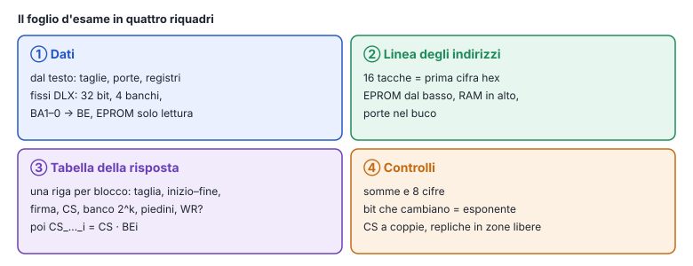
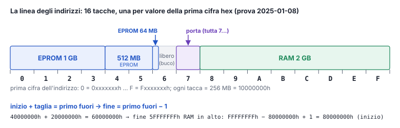
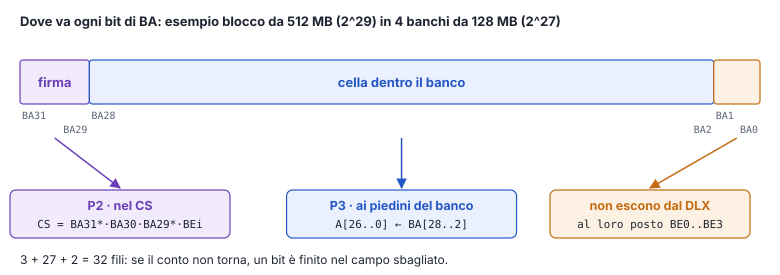
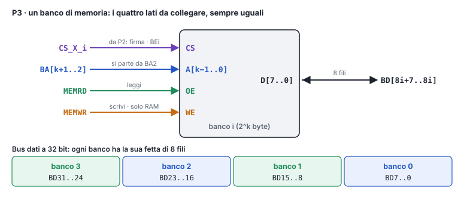
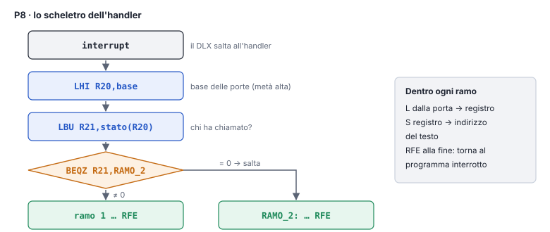
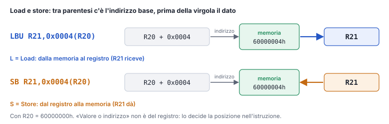
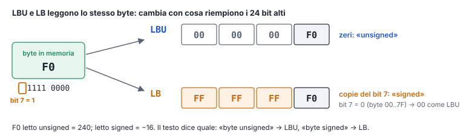
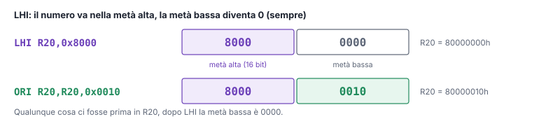

> [!info] Come si usa, e come si lega al cheatsheet
> Questo file segue **la prova**, un pezzo dopo l'altro (metodo a pezzi del 16/11,
> `corsi/CALC/pezzi_prova.md`): per ogni pezzo lo **schema fisso** da riprodurre, le regole, gli
> errori già fatti. Quando un passo richiede un conto (taglie, somme in hex, fine di un blocco,
> negativi) rimanda al [[cheatsheet_conversioni_CALC]] con **→ conti §n**.
> Cresce a ogni sessione (`/lezione`, `/lab`, `/chiudi`): una regola nuova va **nel pezzo a cui
> serve**, un errore nuovo nella sua tabella. Notazione: quella del docente (§6).
> Colori: **blu** regola · **verde** esempio · **arancio** errore già fatto · **viola** perché.

# Il foglio e la procedura



| Riquadro | Cosa ci va |
|---|---|
| ① **Dati** | dal testo + i fissi del DLX: 32 bit, 4 banchi, BA1–0 → BE, EPROM solo lettura |
| ② **Linea degli indirizzi** | a mano: 16 tacche = prima cifra hex; blocchi, buco, porte (→ conti §5) |
| ③ **Tabella della risposta** | una riga per blocco: `blocco · taglia 2^n · inizio–fine · firma · CS · banco 2^k · A[k−1..0] ← BA[k+1..2] · WR?`; poi le 4 righe `CS_…_i = CS · BEi` e il banco i su `BD[8i+7..8i]` |
| ④ **Controlli** | somme, 8 cifre, bit che cambiano = esponente, CS a coppie, repliche in zone libere |

Esempio riempito: artefatto «Prova DLX 8 gennaio 2025», sezione «Su carta»
(https://claude.ai/artifact/5iHgc8vnP9dtjop3fQ8j3w).

**I pezzi della prova** (una sola tipologia in undici anni, consegne a/b/c):

| # | Pezzo | Consegna | Sezione qui |
|---|---|---|---|
| P1 | Mappa | a | §2 |
| P2 | Decodifica | a, b | §3 |
| P3 | Collegamenti delle memorie | b | §4 |
| P4 | Indirizzi delle porte | a | §2 (porte nel buco) |
| P5–P7 | Porte con handshake, interrupt, reti di contorno | b | da scrivere (lezioni 04–05) |
| P8 | Handler | c | §5 |
| P9 | Varianti (signed, half-word/word da più porte) | b, c | §5 |

> [!regola] Chi pilota i bus
> `BA` e `RD/WR`: sempre la CPU. `BD`: la CPU in scrittura, il **dispositivo** in lettura.

# P1 · La mappa



> [!regola] Lo schema fisso *(lezione 02)*
> 1. Scomponi ogni taglia in potenze di due (→ conti §2; se non è una potenza, un blocco per ogni 1
>    del numero in binario).
> 2. **EPROM dal blocco più grande in su, a partire da 0**; **RAM in alto fino a `FFFFFFFFh`**.
>    Controlla l'allineamento: base multipla della taglia (→ conti §5).
> 3. Per ogni blocco **inizio e fine**: fine = inizio + taglia − 1 (→ conti §5).
> 4. Tabella `nome · range · 4 banchi da taglia/4`.
> 5. **Porte** nel buco libero, mai dentro una memoria.

| Regola | Come | Esempio fatto |
|---|---|---|
| **8 cifre sempre** | un indirizzo DLX ha 8 cifre hex | `4000000h` → `04000000h` |
| **Dove mettere una porta** | un indirizzo **tondo** nel buco; scrivi i suoi bit alti e confrontali con le firme: ti fermi al bit che la separa da tutte | buco `64000000h`–`7FFFFFFFh` → `70000000h` = `0111` → `BA31*·BA30·BA29·BA28` |
| **Tacche che non bastano** `[5/11]` | dividi una tacca con il bit successivo | `70000000h` / `78000000h`, separate da `BA27` |
| **Prima le porte, poi semplifichi** | scegli l'indirizzo di ogni porta **prima** di semplificare i CS delle memorie: decide quanto puoi semplificare (P2) | 8 MB a `4…`, INPUT_0 a `5…`, INPUT_1 a `6…` |

# P2 · La decodifica



> [!regola] Lo schema fisso: tre passi, sempre gli stessi
> | Passo | Cosa scrivi | Perché |
> |---|---|---|
> | 1. **Firma** | i bit **alti** fissi su tutto il blocco, letti **in binario** (non sulle cifre hex) | dicono «sei dentro questo blocco» |
> | 2. **Firma minima** | solo i bit che lo separano dai dispositivi **presenti**, porte comprese | all'esame si usa la decodifica semplificata (disp. 02 p. 42) |
> | 3. **· BEi** | un CS per banco: `CS_<nome>_i = firma · BEi`, i = 0..3 | il DLX non porta fuori BA1 e BA0: al loro posto BE0..BE3 (disp. 02 pp. 66, 68) |
>
> **Controllo**: CS a coppie, non devono poter essere veri insieme (due 3-state sullo stesso filo,
> disp. 02 p. 6).

> [!esempio] 2024-01-19, EPROM_8 a `20000000h–207FFFFFh`
> Firma completa `BA31*·BA30*·BA29·BA28*·…·BA23*`. Ma tra `20000000h` e `3FFFFFFFh` non c'è
> nient'altro, quindi il docente scrive **`BA31*·BA30*·BA29·BE0`**. Se una porta stesse a
> `30000000h` servirebbe anche `BA28*`: **dove metti le porte decide quanto puoi semplificare.**

## Leggere la firma

| Regola | Come | Esempio fatto |
|---|---|---|
| **Valore dei bit di firma** | prendi l'**inizio** del blocco, converti in binario le sole cifre che contengono la firma (1ª = BA31..BA28, 2ª = BA27..BA24, 3ª = BA23..BA20), leggi i bit sotto i nomi; controprova sulla fine | 8 MB a `40000000h`: `0100 0000 0` → `BA31*·BA30·BA29*·…·BA23*` |
| **Asterisco** | `*` = bit a **0** (negato); niente asterisco = bit a 1 | `4…` = `0100` → `BA31*·BA30·BA29*·BA28*` |
| **Zona di un CS** | bit del CS + tutti 0 → inizio; bit del CS + tutti 1 → fine. 4 bit coprono 1 cifra hex, 3 bit 2 cifre, 2 bit 4, 1 bit 8 | `010` → `40000000h–5FFFFFFFh` (non `4FFFFFFFh`) |

## Semplificare senza sbagliare

| Regola | Come | Esempio fatto |
|---|---|---|
| **Il CS tiene i bit che separano** | per ogni altro dispositivo, almeno un bit in cui il blocco e quello differiscono | 8 MB `4…` vs INPUT_0 `5…` (BA28) e INPUT_1 `6…` (BA29) → `BA31*·BA30·BA29*·BA28*` |
| **Contro tutti** | il CS si controlla contro **tutti** gli altri chip, EPROM compresa, non solo quelli dello stesso tipo | `CS_RAM_1` ridotto ad `A13*` guardando solo le RAM: manca `A15*` (9/10) |
| **Mutua esclusione** | per ogni coppia (n·(n−1)/2) un bit affermato in uno e negato nell'altro | 512 MB – 64 MB su BA29 · 64 MB – porta su BA28 |
| **Un bit di cella non entra mai** | i bit che cambiano dentro il blocco vanno ai piedini, non al CS | — |

> [!perche] Perché un CS semplificato «invade» (repliche)
> Il CS è una AND sui suoi fili: non sa quanto è grande il chip, si accende su **ogni** indirizzo
> che ha quei bit. `BA31*·BA30` si accende anche su `50000000h`. Ogni bit che non arriva né al CS
> né ai piedini **raddoppia le copie** del chip. È lecito solo se la zona in più contiene spazio
> libero.
>
> **Formula**: c = bit BA nel CS, blocco da 2^k → repliche se c < 32 − k; zona 2^(32−c); copie
> 2^(32−c−k). EPROM 64 MB con CS su `0110`: c = 4, k = 26 → zona 2^28, **4 copie** a
> `60`/`64`/`68`/`6C000000h`. Una porta (0 piedini) con CS su `0111` occupa tutta `7xxxxxxxh`.

## Dai range ai CS su 16 bit *(esercizio 10, 9/10)*

| Passo | Come | Esempio |
|---|---|---|
| 1. **Estremi in binario** | primo e ultimo indirizzo, **a gruppi di 4**, sotto `A15 … A0` | `2000h` = `0010 0000 0000 0000` · `27FFh` = `0010 0111 1111 1111` |
| 2. **Firma** | le colonne **uguali** sopra e sotto (vale per tutto il blocco perché è allineato) | RAM_2: `A15..A11` = `0 0 1 0 0` |
| 3. **Verifica** | i bit che cambiano = esponente della taglia = **piedini** | 11 bit, 2K = 2^11 ✔ |
| 4. **CS** | dalla firma, i bit che separano il chip da **ciascun altro chip** | `CS_RAM_1 = A15*·A13*`: `A15*` contro la EPROM, `A13*` contro RAM_2/3 |
| 5. **Repliche** | un bit di firma omesso fa rispondere il chip anche altrove: lecito solo se lì non c'è nessuno | `CS_EPROM = A15` → attiva su `8000h–FFFFh`, chip solo su `C000h–FFFFh` |

> [!regola] Ordine di lavoro *(idea di Lorenzo, 20/10)*
> Prima **tutte le firme** in una tabella, una riga per dispositivo; poi i CS, confrontando le righe.

# P3 · I collegamenti delle memorie



> [!regola] Lo schema fisso: quattro lati
> | Lato | Regola | Perché |
> |---|---|---|
> | **CS** | quello di P2, uno per banco: `CS_X_i = firma · BEi` | — |
> | **Indirizzi** | banco da 2^k byte → **k piedini**, fili **da BA2**: `A[k−1..0] ← BA[k+1..2]` | BA1–BA0 sono diventati i BE |
> | **OE / WE** | `MEMRD → OE`, `MEMWR → WE`; **EPROM solo OE** | il chip deve sapere se leggere o scrivere; la EPROM non si scrive |
> | **Dati** | 8 fili per banco: banco i su `BD[8i+7..8i]` | 32 bit / 4 banchi = 8 |

| Regola | Come | Esempio fatto |
|---|---|---|
| **Dimensione del banco** | taglia del blocco / 4 | blocco 512 MB → banchi da 128 MB = 2^27 |
| **Ultimo BA** | ultimo BA = numero di piedini + 1 | 2 MB = 2^21: `A[20..0] ← BA[22..2]` (non `BA[21..2]`: 20 fili per 21 piedini) |
| **Controprova** | piedini + bit del CS + BA1–0 = 32 fili | 27 + 3 + 2 = 32 |
| **RD/WR va scritto** | nelle connessioni: EPROM solo `MEMRD`, RAM `MEMRD` e `MEMWR` | soluzione 2023-12-21 |
| **Banchi sul bus** | banco 0: `BD7..0` · 1: `BD15..8` · 2: `BD23..16` · 3: `BD31..24` | — |
| **CS di un banco** | niente da calcolare: CS del blocco · BEi | `CS_EPROM_1GB_0 = BA31*·BA30*·BE0` |
| **Due porte mutuamente esclusive** | la soluzione le mette **allo stesso indirizzo** (`CS_INPUT·ACTIVE_0` / `·ACTIVE_0*`): moduli 04–05 | soluzione 2023-12-21 |

# P8 · Il codice: l'handler



> [!regola] Lo schema fisso *(lezione 03)*
> 1. Per ogni indirizzo fisso che il codice usa: `LHI Rx,<16 bit alti>`, poi load/store con
>    offset = 16 bit bassi (se l'offset è ≥ `8000h` *sottrae*: è esteso con segno). Per un
>    indirizzo appena sotto `FFFFFFFFh` basta `SUBI Rx,R0,n` (→ conti §4).
> 2. Scegli l'istruzione dal testo: word → `LW`/`SW`; byte o half-word **signed** → `LB`/`LH`;
>    **unsigned** → `LBU`/`LHU`.
> 3. Usa solo i registri che il testo concede (es. `R20–R25`); `R0` vale sempre 0.
> 4. Confronti: `Sx` in un registro, poi `BEQZ`/`BNEZ` su quel registro.
> 5. Gli indirizzi del codice sono **gli stessi** della mappa (consegna b): ricontrollali lì.
> 6. Ogni ramo finisce con **`RFE`**.

> [!esempio] Handler della 2023-01-17
> ```
> LHI  R20,0x6000          ; R20 = 60000000h, base della porta
> LW   R21,0x0000(R20)     ; legge la word dalla porta
> LHI  R22,0xF000          ; R22 = F0000000h
> SW   R21,0x0008(R22)     ; la scrive a F0000008h
> RFE                      ; torna al programma interrotto
> ```

```
LHI   Rbase,0x....          ; base delle porte
LBU   Rx,off_stato(Rbase)   ; chi ha chiamato / quale porta è attiva
BEQZ  Rx,ALTRO_RAMO
  ... ramo 1: L dalla porta → registro, S registro → indirizzo del testo
RFE
ALTRO_RAMO:
  ... ramo 2
RFE
```

## Load e store: chi dà e chi riceve



Forma unica: `ISTR Ra,offset(Rb)` → indirizzo = Rb + offset. **Tra parentesi** l'indirizzo base;
**prima della virgola** il dato. **L = memoria → Ra**, **S = Ra → memoria**.

| Istruzione | Cosa fa | Bit alti di Ra | Esempio |
|---|---|---|---|
| ★ `LBU` | legge **1 byte** | zeri (unsigned) | `LBU R21,0x0000(R20)`: byte a 60000000h → R21 |
| ★ `LB` | legge **1 byte** | copie del bit 7 (signed) | per dati *signed* |
| `LHU` | legge **2 byte** | zeri | `8081` → `00008081` |
| `LH` | legge **2 byte** | copie del bit 15 | `8081` → `FFFF8081` |
| `LW` | legge **4 byte** | — (riempie tutto) | `LW R3,0800(R2)` |
| ★ `SB` | scrive il **byte basso** di Ra | — | `SB R21,0x0000(R22)`: R21 → FFFFFFF0h |
| `SH` | scrive i **2 byte bassi** | — | R2 = `00000081` → scrive `0081` |
| `SW` | scrive **tutti i 4 byte** | — | `SW R2,0800(R3)`: R2 a R3+0800 |

★ = usata negli handler delle prove viste.



> [!attenzione] Allineamento
> Indirizzo **multiplo della taglia**: half-word → ultima cifra `0 2 4 6 8 A C E`; word →
> `0 4 8 C`. `SH …,0x7FF1(R1)` non è allineata (sl. 46).

## Mettere un numero in un registro



| Istruzione | Cosa fa | Esempio |
|---|---|---|
| ★ `LHI Ra,Imm16` | Imm16 nella **metà alta**, metà bassa **sempre** a 0 | `LHI R20,0x8000` → `80000000h` |
| `ORI Ra,Ra,Imm16` | aggiunge la metà bassa dopo una `LHI` | → `80000010h` |
| ★ `ADDI Ra,R0,n` | Ra = n (piccolo, entro 16 bit) | `ADDI R2,R0,20h` → R2 = 32 |
| ★ `SUBI Ra,R0,n` | Ra = −n: indirizzo appena sotto `FFFFFFFFh` (→ conti §4) | `SUBI R22,R0,0x0010` → `FFFFFFF0h` |

Offset e immediati: 16 bit nella metà **bassa**, estesi con segno, sommati (`0800` → `00000800`);
solo `LHI` va nella metà alta.

## Conti, confronti, salti, interrupt

| Istruzione | Cosa fa |
|---|---|
| `ADD Ra,Rb,Rc` · `ADDI Ra,Rb,Imm16` | Ra = Rb + Rc · Ra = Rb + Imm16 |
| `SUB` · `SUBI` | Ra = Rb − Rc · Ra = Rb − Imm16 |
| `ADDU`, `ADDUI`, `SUBU`, `SUBUI` | come sopra, senza segno (immediato esteso con zeri) |
| `AND`, `ANDI`, `OR`, `ORI`, `XOR`, `XORI` | bit a bit; `XOR R8,R8,R8` azzera R8 |
| `SLL`, `SLLI` | sposta a sinistra (×2 per posizione, entrano zeri) |
| `SRL`, `SRLI` · `SRA`, `SRAI` | a destra: entrano zeri (÷2 unsigned) · entra il bit di segno (÷2 signed) |
| `Sx Ra,Rb,Rc` · `SxI Ra,Rb,Imm16` | Ra = **1** se vero, **0** se falso; x = `LT GT LE GE EQ NE`. `SNEI R4,R2,8` → R4 = 1 se R2 ≠ 8 |
| ★ `BEQZ Ra,ETICHETTA` | salta se Ra **= 0** (Branch if EQual to Zero), altrimenti riga dopo |
| `BNEZ Ra,ETICHETTA` | salta se Ra **≠ 0** |
| `J ETICHETTA` · `JR Ra` | salta sempre · all'indirizzo contenuto in Ra (`JR R31`) |
| `JAL ETICHETTA` / `JALR Ra` | salta e salva in R31 l'indirizzo di ritorno |
| ★ `RFE` | **fine dell'handler**: torna al programma interrotto |
| `MOVS2I Ra,IAR` · `MOVI2S IAR,Ra` | copiano fra un registro e IAR, l'indirizzo di ritorno (modulo 04) |

Offset di un salto: `destinazione − (indirizzo del salto + 4)` su 16 bit (→ conti §4).
**Ciclo senza `SNEI`**: contatore che **scende** a 0 e `BNEZ` su di lui, con l'indirizzo che scende
insieme (ciclo a 4 istruzioni, sl. 48 ii).

> [!regola] Fonte
> Dispensa 03, «Elenco istruzioni del DLX (integer)» e slide degli esempi (sl. 46–48); soluzioni
> 2023-02-09 e 2023-12-21. In `Ra,Rb,Rc`: Ra = **destinazione** (o il dato, in load/store), Rb e Rc =
> **sorgenti**; Imm16 = numero scritto nell'istruzione.

## P9 · Signed e unsigned nei testi

| Uso nel testo | Esempio | Conseguenza nel codice |
|---|---|---|
| tipo del dato, scritto della stessa larghezza | «byte unsigned … scritto come byte» (2023-02-09) | `LBU`/`LB` secondo il testo; con `SB` dopo, in memoria non cambia nulla |
| scritto **più largo** di come è letto | «16 bit signed … memorizzati come word» (2021-12-23) | conta: `LH` + `SW` (bit alti = copie del segno); con `LHU` il valore cambia |
| confrontato o usato in un conto | «signed tra +1 e +15» (2023-06-15); «valore assoluto» (2021-09-02) | il segno decide il confronto: `81h` = −127 signed, 129 unsigned |

> [!regola] Nel testo sottolinea due cose
> **signed / unsigned** e **come byte / half-word / word**.

# Notazione del docente

Forme da riprodurre identiche nell'elaborato.

| Cosa | Forma del docente | Fonte |
|---|---|---|
| prodotto, negazione | `BA31*·BA30·BE0` (`·` e `*` postfisso) | soluzione 2025-01-08 p. 3 |
| tabella memorie | `RAM  80000000h:FFFFFFFFh, 4 banchi da 512 MB` | soluzione 2025-01-08 p. 2 |
| nome dei CS per banco | `CS_EPROM_1GB_0` … `_3`, `CS_RAM_0` … `_3` | soluzione 2025-01-08 p. 3 |
| comando con verso | `… ·MEMWR` / `… ·MEMRD` in coda | dispensa 02 p. 47 |
| collegamenti banco | `BA[30..2]` → `A[28..0]`; RAM: `RD WR CS`; EPROM: `RD CS` | soluzione 2025-01-08 pp. 9–12 |

**Criticità segnalate dalle soluzioni**: due driver 3-state sullo stesso filo, mai OE attivi
insieme → CS mutuamente esclusivi (dispensa 02 p. 6).

# Errori già fatti, per pezzo

Da rileggere prima di un drill. Gli errori di conto stanno nel cheatsheet, accanto alla regola.

| Pezzo | Errore | Quando | Contromisura |
|---|---|---|---|
| P1 | blocco da 2 GB scomposto in 2000 MB | 20/10 | 2 GB = 2048 MB = 2^31 |
| P1 | `FFFFFFFFh − taglia + 1` preso come fine | 20/10 | è l'**inizio** del blocco in alto |
| P1 | OUT dentro la RAM, porte contate 3 | 5/11 | le porte solo nel buco libero |
| P2 | `CS_RAM_1` ridotto ad `A13*` confrontando solo le RAM | 9/10 | controllare **tutti** gli altri chip |
| P2 | decodifica di EPROM_8 completa, non minima | 16/11 | firma minima rispetto alla mappa |
| P2 | asterisco messo su un bit a 1; firma non letta in binario | 16/11 | firma in **binario**, `*` = bit a 0 |
| P2 | BE non ricordati | 5/11, 16/11 | terzo passo fisso: `· BEi` |
| P3 | firma messa sui piedini (CS e indirizzi fusi) | 16/11 | firma → CS; i bit di mezzo → piedini |
| P3 | 128 MB contati come 7 piedini; 2 MB preso come 2^20 | 16/11 | taglia → potenza → banco = /4 → k |
| P3 | OE/WE invertiti o dimenticati | 5/11, 16/11 | MEMRD → OE, MEMWR → WE |
| P3 | BD per banco sbagliati (16..24 / 25..31) | 16/11 | banco i su `BD[8i+7..8i]` |
| P8 | verso di L/S confuso | 16/11 | L riceve nel registro, S dà dal registro |
| P8 | `BEQZ` non ricordato a mezz'ora | 16/11 | BEQZ = salta se **uguale a zero** |
| P8 | `LB` riempie «di F»: solo se il bit 7 è 1 | 18/11 | LB copia il bit 7 |
| P8 | `LHI` azzera la metà bassa «se non configurata» | 18/11 | la azzera **sempre** |
| P8 | `SUBI R22,R0,0x000F` per `FFFFFFF0h` | 18/11 | → conti §4: la distanza è 10h |
